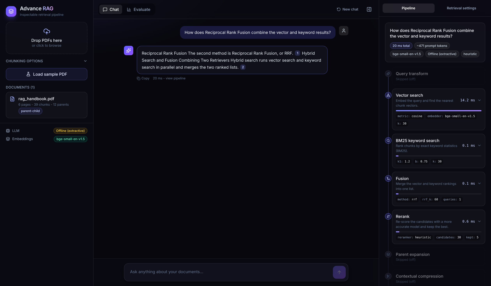
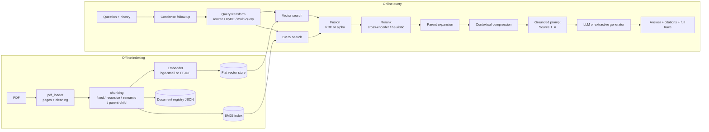

# Advance RAG

**Advanced Retrieval-Augmented Generation over your PDFs: hybrid search, reranking, query transformation and a pipeline inspector that shows exactly how every answer was produced.**

[](https://github.com/M-U-Rony/advance-rag/actions/workflows/ci.yml)




The retrieval core (TF-IDF, BM25, vector store, fusion, reranking heuristics, query transforms, evaluation metrics) is implemented **from scratch** in TypeScript as teaching-grade, documented modules. The whole system runs **fully offline**: with no API key it falls back to TF-IDF embeddings and an extractive answerer, and upgrades automatically to a dense model, a cross-encoder and any LLM you configure.

## Features

- **Ingestion**: PDF parsing with page numbers; four chunking strategies (fixed window, recursive, heading-aware, parent-child).
- **Hybrid search**: vector + BM25 in parallel, fused with Reciprocal Rank Fusion or alpha-weighted min-max blending.
- **Reranking**: cross-encoder (`ms-marco-MiniLM-L-6-v2`) over 30 candidates, with a dependency-free heuristic fallback.
- **Query transformation**: LLM rewriting, HyDE, multi-query + RRF, and history-aware question condensing (last 3 exchanges). Each has an offline fallback.
- **Parent-child retrieval**, **metadata pre-filtering** (document, page range), **contextual compression**.
- **Grounded generation** with `[Source i]` labelled context, citations, and an explicit "I don't have enough information" fallback. Streaming over SSE.
- **Pipeline Inspector UI**: per-stage latency bars, hits with scores, rewritten queries, HyDE text, every setting tweakable with tooltips.
- **Evaluation**: Recall@k, precision, MRR, faithfulness and answer relevance for vector vs BM25 vs hybrid vs hybrid+rerank, from the CLI or the UI.
- **Providers**: Groq / OpenAI / Gemini / Ollama (OpenAI-compatible) and Anthropic; offline mode needs nothing.

## Architecture



## Concepts implemented

| Concept | File | What it does |
|---|---|---|
| Retrieve, Augment, Generate | `backend/src/pipeline.ts` | Orchestrates both phases and records a trace of every stage |
| Fixed / recursive / heading-aware chunking | `backend/src/ingestion/chunking.ts` | Sliding word window with overlap; sections to paragraphs to sentences; sections kept with their heading |
| Parent-child chunking | `backend/src/ingestion/chunking.ts`, `pipeline.ts` | Index ~50-word children, return their ~200-word parents to the LLM |
| TF-IDF from scratch | `backend/src/embeddings/tfidf.ts` | `idf = ln((n+1)/(df+1)) + 1`, L2-normalised sparse baseline |
| Dense embeddings | `backend/src/embeddings/dense.ts` | `Xenova/bge-small-en-v1.5` via Transformers.js (ONNX), lazy, falls back to TF-IDF |
| Vector store + cosine / dot / L2 | `backend/src/retrieval/vectorStore.ts` | Brute-force flat index over a `Float32Array`, metadata filter, JSON + raw float32 persistence |
| BM25 from scratch | `backend/src/retrieval/bm25.ts` | k1=1.2, b=0.75, indexing, scoring, top-k search |
| Hybrid fusion (RRF, alpha) | `backend/src/retrieval/fusion.ts` | `sum 1/(60+rank)` or `alpha*vec + (1-alpha)*kw` on min-max scores |
| Reranking | `backend/src/retrieval/rerank.ts` | Cross-encoder (Transformers.js) over top-N candidates; heuristic (stop words, overlap, bigrams, early position) fallback |
| Query transformation | `backend/src/retrieval/queryTransform.ts` | Rewrite, HyDE, multi-query, history condensing, each with an offline fallback |
| Metadata pre-filtering | `backend/src/retrieval/filters.ts` | Restrict by document or page range before ranking |
| Contextual compression | `backend/src/retrieval/compression.ts` | Keep only query-relevant sentences |
| Grounded prompts and citations | `backend/src/generation/prompts.ts` | `[Source i]` labels, "use ONLY the context", refusal sentence |
| Provider abstraction + offline mode | `backend/src/generation/llm.ts` | OpenAI-compatible, Anthropic, extractive generator |
| Conversation-aware RAG | `prompts.ts`, `queryTransform.ts` | Last 3 exchanges kept, follow-ups condensed to standalone queries |
| Evaluation | `backend/src/evaluation/` | Recall@k, precision, MRR, overlap faithfulness (0.5 threshold), optional LLM judge, CLI + API |

## Quickstart

### Docker (one line)

```bash
docker compose up --build   # then open http://localhost:8000
```

Optionally `cp .env.example .env` first to plug in an LLM. Or pull the published image: `docker run -p 8000:8000 -v rag-data:/data ghcr.io/m-u-rony/advance-rag:latest`.

### Local development

```bash
make install          # npm ci for backend and frontend (Node 22+)
make dev              # API on :8000 and Vite on :5173 (proxying /api)
```

Open http://localhost:5173, click **Load sample PDF**, and ask a question. Without any configuration the app runs offline (extractive answers, bge-small if it can be downloaded, otherwise TF-IDF).

For real LLM answers, the free Groq tier is recommended:

```bash
LLM_PROVIDER=openai_compatible
LLM_BASE_URL=https://api.groq.com/openai/v1
LLM_MODEL=llama-3.3-70b-versatile
LLM_API_KEY=gsk_...
```

## Configuration

| Variable | Default | Description |
|---|---|---|
| `LLM_PROVIDER` | `none` | `none`, `openai`, `openai_compatible`, `anthropic` |
| `LLM_API_KEY` | | API key for the provider |
| `LLM_MODEL` | provider default | Model name (e.g. `llama-3.3-70b-versatile`) |
| `LLM_BASE_URL` | | Endpoint for `openai_compatible` (Groq, Gemini, Ollama, vLLM...) |
| `EMBEDDING_BACKEND` | `auto` | `auto` (dense, else TF-IDF), `dense`, `tfidf` |
| `EMBEDDING_MODEL` | `Xenova/bge-small-en-v1.5` | Transformers.js (ONNX) model id; `BAAI/<name>` is mapped to `Xenova/<name>` |
| `RERANKER_MODEL` | `Xenova/ms-marco-MiniLM-L-6-v2` | Transformers.js cross-encoder id |
| `MODEL_DTYPE` | `fp32` | `fp32`, `fp16` or `q8` (smaller and faster) |
| `MODEL_CACHE_DIR` | `<DATA_DIR>/models` | Where downloaded models are cached |
| `PORT` / `HOST` | `8000` / `0.0.0.0` | HTTP listener |
| `DATA_DIR` | `./data` | Documents, chunks and cached vectors |
| `STATIC_DIR` | `backend/static` | Built frontend served at `/` |
| `CORS_ORIGINS` | localhost:5173 | Comma separated allowed origins |
| `MAX_UPLOAD_MB` | `50` | Upload size limit |

## API reference

| Method | Path | Description |
|---|---|---|
| `GET` | `/api/health` | Liveness probe |
| `GET` | `/api/config` | Active LLM, embedding and reranker backends |
| `GET` | `/api/documents` | Indexed documents |
| `POST` | `/api/documents` | Multipart PDF upload (`file`, `strategy`, `chunk_size`, `chunk_overlap`, `parent_size`, `child_size`) |
| `POST` | `/api/documents/sample` | Index the bundled sample PDF (idempotent) |
| `DELETE` | `/api/documents/{id}` | Remove a document |
| `POST` | `/api/query` | `{question, history, settings}` returns answer, citations, trace |
| `POST` | `/api/query/stream` | SSE: `trace` event first, then `token` events, then `done` |
| `POST` | `/api/evaluate` | Recall@k etc. for vector / BM25 / hybrid / hybrid+rerank |

`settings` accepts `retrieval_mode` (`vector|bm25|hybrid`), `fusion` (`rrf|weighted`), `alpha`, `top_k`, `candidates`, `rerank` (`none|heuristic|cross_encoder`), `query_transform` (`none|rewrite|hyde|multi_query`), `parent_child`, `compression`, `similarity` (`cosine|dot|l2`), `doc_ids`, `page_min`, `page_max`.

```bash
curl -X POST localhost:8000/api/documents/sample
curl -X POST localhost:8000/api/query -H 'content-type: application/json' \
  -d '{"question":"What value of k does RRF use?","settings":{"retrieval_mode":"hybrid","rerank":"cross_encoder"}}'
```

## Evaluation results

`make eval` (`npm run eval -- ../samples/rag_handbook.pdf` in `backend/`) runs the evaluation CLI on `samples/rag_handbook.pdf` (6 pages, recursive chunking, 120 words) with 24 hand-written questions (`samples/rag_handbook_qa.json`). A chunk is relevant if it contains the question's evidence phrase. Answers come from the offline extractive generator, so the faithfulness and relevance columns reflect that fallback, not an LLM.

Dense embeddings (`bge-small-en-v1.5`):

| Config | Recall@1 | Recall@3 | Recall@5 | P@5 | MRR | Faithful | AnsRel | ms |
|---|---:|---:|---:|---:|---:|---:|---:|---:|
| vector | 0.83 | 1.00 | 1.00 | 0.20 | 0.90 | 0.94 | 0.54 | 13.5 |
| bm25 | 0.88 | 0.96 | 0.96 | 0.30 | 0.92 | 0.88 | 0.55 | 0.2 |
| hybrid (RRF) | 0.83 | 0.96 | 1.00 | 0.20 | 0.90 | 0.91 | 0.55 | 14.0 |
| hybrid + cross-encoder | 0.92 | 1.00 | 1.00 | 0.20 | 0.95 | 0.86 | 0.55 | 695.2 |

TF-IDF fallback (`EMBEDDING_BACKEND=tfidf`):

| Config | Recall@1 | Recall@3 | Recall@5 | P@5 | MRR | Faithful | AnsRel | ms |
|---|---:|---:|---:|---:|---:|---:|---:|---:|
| vector | 0.71 | 0.96 | 0.96 | 0.19 | 0.83 | 0.94 | 0.55 | 0.6 |
| bm25 | 0.88 | 0.96 | 0.96 | 0.30 | 0.92 | 0.88 | 0.55 | 0.2 |
| hybrid (RRF) | 0.83 | 0.96 | 0.96 | 0.19 | 0.90 | 0.96 | 0.55 | 0.3 |
| hybrid + cross-encoder | 0.92 | 1.00 | 1.00 | 0.20 | 0.95 | 0.86 | 0.55 | 671.1 |

Takeaways: reranking gives the best ranking quality (MRR 0.95) at roughly 700 ms per query on CPU; the dense model beats TF-IDF at Recall@1 for vector search (0.83 vs 0.71); on this small, clean document all configurations reach high Recall@5, so differences show mostly in the top ranks. The set is small (24 questions), so treat the numbers as illustrative. (The numbers match the previous implementation exactly when run on the previous PDF text, which is how the port was validated.)

## Project structure

```
advance-rag/
├── backend/                  Node.js + TypeScript + Fastify
│   ├── src/
│   │   ├── server.ts  app.ts  config.ts  pipeline.ts  store.ts  types.ts  schemas.ts  text.ts  runtime.ts
│   │   ├── api/routes.ts
│   │   ├── ingestion/        pdfLoader.ts  chunking.ts
│   │   ├── embeddings/       types.ts  tfidf.ts  dense.ts
│   │   ├── retrieval/        vectorStore.ts  bm25.ts  fusion.ts  rerank.ts
│   │   │                     queryTransform.ts  compression.ts  filters.ts
│   │   ├── generation/       llm.ts  prompts.ts
│   │   └── evaluation/       metrics.ts  evaluator.ts  cli.ts  runEval.ts
│   ├── test/                 Vitest suites (offline)
│   ├── scripts/              generateSamplePdf.ts (builds samples/rag_handbook.pdf)
│   └── package.json  tsconfig.json  eslint.config.js  vitest.config.ts
├── frontend/                 React + Vite + TypeScript + Tailwind
│   └── src/components/       Sidebar  Chat  Inspector  SettingsPanel  EvaluateView
├── samples/                  rag_handbook.pdf + rag_handbook_qa.json
├── Dockerfile  docker-compose.yml  Makefile  .env.example
└── .github/workflows/ci.yml
```

## Testing

```bash
make test   # vitest with v8 coverage (175 tests, 99% line coverage, fully offline)
make lint   # eslint + prettier + tsc for the backend, typecheck + eslint for the frontend
```

Tests force `EMBEDDING_BACKEND=tfidf` and no LLM; they cover chunking, TF-IDF and BM25 known values, RRF and weighted fusion, vector-store metrics and persistence, parent-child mapping, prompt building, the pipeline end to end on generated PDFs and the sample handbook, the dense-vector cache, the LLM clients (with fake SDKs), the evaluation CLI, and the HTTP API via `fastify.inject` (including SSE).

## CI/CD

`.github/workflows/ci.yml` runs on every push and pull request:

1. **backend**: `npm run lint`, `format:check`, `typecheck`, `npm test` with coverage (uploaded as an artifact) and `npm run build`.
2. **frontend**: `npm ci`, typecheck, eslint, production build.
3. **docker**: buildx build of the multi-stage image; on pushes to `main` it is published to `ghcr.io/<owner>/advance-rag` (lowercased) using `GITHUB_TOKEN` with `packages: write`.

## Known limitations

- The offline extractive generator quotes sentences; it cannot paraphrase or reason across passages (for example it misses "zero" vs "0"). Configure an LLM for fluent answers.
- Text-only PDFs: scanned documents need OCR first. Chunking is per page, so passages never span a page break.
- The flat index is exact but linear; it is intended for thousands to hundreds of thousands of chunks.
- The Docker image was not built in the authoring sandbox (no daemon available); CI builds it.

## Roadmap

- GraphRAG: entity/relationship graph for multi-hop and global questions
- Self-RAG: let the model decide when to retrieve and critique its own passages
- Corrective RAG (CRAG): grade retrieval quality and fall back to web or re-query
- ColBERT-style late interaction retrieval
- OCR for scanned PDFs, approximate indexes (HNSW) for large corpora

## License

MIT, see [LICENSE](LICENSE).
